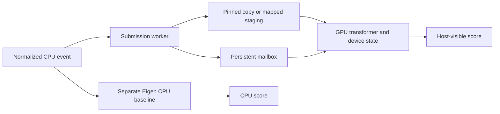

# Streaming runtime architecture

The final target is one NVIDIA RTX PRO 5000 Blackwell (SM120). Shapes and the numerical mode are fixed for the lifetime of a runtime. A runtime owns one ordered stream; it does not batch events or distribute one model across GPUs.

CPU and GPU inference are independent paths. The GPU path performs projection, normalization, RoPE, cache insertion, attention, feed-forward operations, residuals and the score head on the GPU. The CPU submits inputs and commands and observes completion. It computes an oracle only during correctness/stress runs explicitly requesting one. Such runs are excluded from latency evidence.

## State and tensor ownership

`Model` owns validated host tensors and their manifest. Matrix weights are row-major `[out_features, in_features]`. `Cpu` owns preallocated Eigen scratch and a separate cache. `Runtime::Impl` owns CUDA streams, events, weights, workspace, mapped pinned input/output/mailbox buffers, device-held absolute position and per-layer K/V rings. Owners are noncopyable and destructors join persistent execution before releasing its resources.

K and V are separate `[layer, head, window_slot, head_dimension]` tensors. At absolute position `t`, the layer writes slot `t % W`, then attends to `max(0, t-W+1)..t`, including the current event. Historical entries retain the values computed on arrival. Higher layers therefore retain information from evicted raw inputs; recomputing independent raw-input windows is not equivalent.

Reset sets the device position to zero and clears state. Every layer has its own cache. Correctness snapshots compare complete caches, hidden vectors, outputs and positions, including unfilled slots, eviction and reset. The CPU attention implementation visits physical ring order; applying the same permutation to keys and values preserves attention. The custom CUDA attention explicitly maps chronological indices to ring slots.

## Execution backends

| Backend | Projections/FFN | Coordination |
|---|---|---|
| CPU | Eigen matrix/vector operations | Host control flow |
| cuBLAS | cuBLAS FP32 or FP16-input/FP32-accumulation operations | Conventional launches with custom support kernels |
| cuBLAS graph | Same operations | Captured fixed-address CUDA graph |
| Custom CUDA | Device-callable warp-row GEMV and common primitives | Conventional kernel sequence |
| Custom graph | Same custom primitives | Captured fixed-address CUDA graph |
| Fused | Same custom primitives | One block or occupancy-validated cooperative grid, one forward per launch |
| Persistent | Same fused forward | One long-lived program handling RUN/RESET/STOP |

Graph replay captures buffer addresses and operations, not a host event index. Absolute position and valid length remain on device. Persistent execution does not call host cuBLAS. Ordinary and graph paths support ordered pinned transfers and mapped staging; comparisons record which transport was used.

Each warp owns a GEMV output row. Projection/FFN rows are distributed over the grid. Attention logit warps own head/history entries; attention output threads own output coordinates. Softmax has one owner per head and uses maximum subtraction. Phase barriers separate producers and consumers. One-block execution uses block barriers; multi-block execution uses cooperative grid synchronization with identical control flow for every participating thread.

Cooperative capacity is computed from the actual compiled persistent and fused kernels, thread count and shared memory. Candidate block counts are filtered against that capacity. An all-SM grid is a candidate, not a default or proof that blocks occupy distinct SMs. Runtime metadata names the kernel whose register/local/shared resource values it reports; cuBLAS internals require profiler evidence.

## Numerical modes

FP32 uses FP32 weights, activations, cache and reductions, with TF32 and fast math disabled. Mixed uses FP16 weights/cache and explicitly rounded intermediate activations; scratch and reductions remain FP32. RoPE rotates in FP32 before rounding. The final score accumulates in FP32 without a final FP16 cast. The cuBLAS mixed input projection retains FP32 inputs with a float view of the frozen input weights. The PyTorch comparison uses the same exception and FP16 matrix operands with FP32 output/accumulation for later linears.

Primitive tests inherit `--fmad=false`, matching runtime CUDA compilation. Actual CPU and CUDA diagnostic paths capture operands and pre/post-cast values outside performance runs. End-to-end acceptance and original raw diagnostics are specified in [NumericalPolicy.md](NumericalPolicy.md).

## Lifetime and bounded execution

Each state has one outstanding command. Completion IDs identify results even when scores repeat or are zero. STOP is idempotent at the host interface. Finite RUN counts and an idle-cycle budget allow bounded diagnostic execution; device-only profiling preloads a finite trace and never waits for a profiler to emulate host acknowledgements. The idle budget is expressed in device clock cycles derived from the queried clock rate; dynamic clocks can change its wall duration.

Sequence exhaustion leaves the final ID available for STOP. Reusing a runtime after exhaustion is rejected; constructing a new runtime initializes a new mailbox and model state. Lifecycle tests cover finite/idle exits, reset, repeated outputs, exhaustion, STOP and reconstruction. These bounded tests are separate from the million-RUN acceptance gate.

Weights are currently streamed through the device memory hierarchy. No resident-weight speedup is claimed. Shared/register staging must be justified by resource and profile evidence, including allocation, spills, occupancy and traffic; summed hardware capacity alone does not prove residency or benefit.
